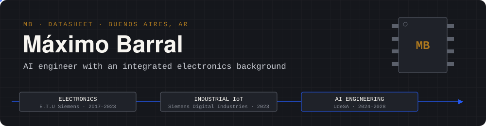

  

## About me

I came to artificial intelligence from electronics. I trained as an electronics technician, interned in industrial IoT
at Siemens, and I'm now in my third year of **AI Engineering at Universidad de San Andrés**, on a merit scholarship.

What I enjoy most is **modelling**: translating a real problem into mathematical terms, checking the assumptions behind
each approach and choosing the one that best describes the phenomenon. Having started from the hardware, I like to know
what is actually happening underneath, from raw signals to bytes on disk. On the side, I build skills and tools for AI
agents that automate my own workflow.

## Tech stack

| | |
|:--|:--|
| **Machine learning** |      |
| **Languages** |     |
| **Automation & IoT** |    |
| **Tooling** |    |

## Featured projects

| Project | |
|:--|:--|
| 🎧 **[music-genre-recognition](https://github.com/BarralMaximo/music-genre-recognition)** PyTorch · Hugging Face · FastAPI | Genre recognition from raw audio, comparing handcrafted features (eGeMAPS) against self-supervised embeddings (wav2vec 2.0, MERT, CLAP). The final ensemble reaches a **weighted F1 of 0.767** on FMA Medium, always tested on artists the model never heard. It ships with a live demo and was presented at AI Fest and the UdeSA AI Symposium. |
| ⬡ **[hexbot_priapo](https://github.com/BarralMaximo/hexbot_priapo)** Python · MCTS + RAVE · NumPy | Hex-playing agent built on Monte Carlo Tree Search with RAVE, virtual connections and search-tree reuse. It finished **3rd of 83** in a university tournament, with 0% errors and 0% timeouts, using about half the thinking time of the two agents above it. |
| 🗂️ **[NTFS_Reader](https://github.com/BarralMaximo/NTFS_Reader)** C11 · libc only | Read-only NTFS explorer written from the on-disk format up: MFT records, data runs, B+ tree indexes, sparse files and alternate data streams. The disk image is treated as untrusted input, so every offset is bounds-checked. |
